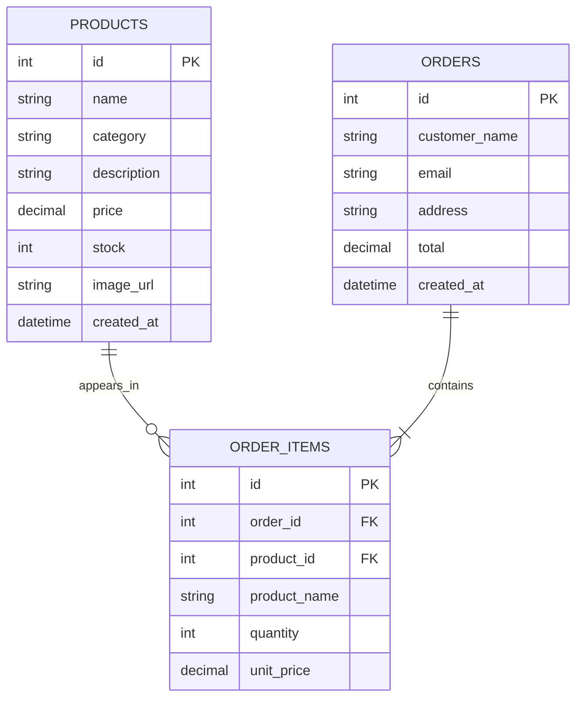

# NovaCart — E-Commerce Store Mini Project

**Student:** Bandara K.M.S.N  
**Registration No:** EG/2023/5515  
**Course:** EC4307 Web Application Development  
**Topic:** E-Commerce Store

## Overview
NovaCart is a responsive e-commerce mini project built with Python Flask, SQLite, HTML and CSS. It includes a product storefront, search/filter/sort, product details, a session-based shopping cart, demo checkout, stock updates, order history and product CRUD management.

## Main features
- **Create:** Add a product using a validated form.
- **Read:** View product cards/details, search, category filter and sort; review orders and order details.
- **Update:** Edit existing products and update cart quantities.
- **Delete:** Delete a product with a browser confirmation.
- Server-side validation for required fields, numeric price/stock, email format, stock availability and quantities.
- Persistent SQLite database with products, orders and order_items tables and foreign-key relationships.
- Responsive layouts for desktop and mobile.
- Sample data is inserted automatically on first run.

## Requirements
- Python 3.10 or newer
- pip

## Run locally
1. Extract the ZIP and open a terminal in the `ecommerce_store` directory.
2. Create and activate a virtual environment (recommended):
   - Windows: `py -m venv .venv` then `.venv\\Scripts\\activate`
   - macOS/Linux: `python3 -m venv .venv` then `source .venv/bin/activate`
3. Install dependencies: `pip install -r requirements.txt`
4. Start the app: `python app.py`
5. Open `http://127.0.0.1:5000` in a browser.

SQLite database `store.db` is created automatically at first startup. Keep this file to retain data; delete it only if you want to reset the demo data.

## Routes
- `/` — Storefront, search, filter and sort
- `/product/<id>` — Product details
- `/cart` — Cart and quantity updates
- `/checkout` — Demo checkout
- `/admin/products` — Product CRUD
- `/admin/orders` — Order listing

## Database design / ERD

## Test checklist
1. Create a product with valid data and confirm it appears in the product list.
2. Submit a blank name, negative price or negative stock and confirm validation blocks it.
3. Search for a product; filter by category; sort by price ascending and descending.
4. Edit a product and confirm the changes persist after refreshing.
5. Delete a test product and confirm it is removed.
6. Add an item to the cart, change quantity and confirm subtotal/total calculations.
7. Try a quantity above stock; confirm it is rejected.
8. Place a demo order and verify the order appears under Orders and stock decreases.
9. Resize browser to mobile width and check navigation and product cards.

## Limitations and security notes
This is a learning/demo project, not a production-ready commerce platform. It does not collect real payments, authenticate administrators, send emails, or provide CSRF protection. Add authentication/authorization, CSRF protection, secure secret management, HTTPS, logging, tests and a real payment gateway before deployment. The development server uses debug mode; do not expose it publicly. Replace the demo secret key via the `SECRET_KEY` environment variable.

## Academic submission checklist
- Replace sample product data with your own appropriate demo content.
- Run and test the project on your computer; capture genuine screenshots of your running application.
- Review and understand every part of the code, then adapt it yourself and follow your institution's rules on AI assistance and code similarity.
- Submit the GitHub repository link through the class Google Sheet.
- Submit a project report of no more than 10 pages and a demonstration video no longer than 5 minutes, with your camera on, as stated in the supplied rubric.
